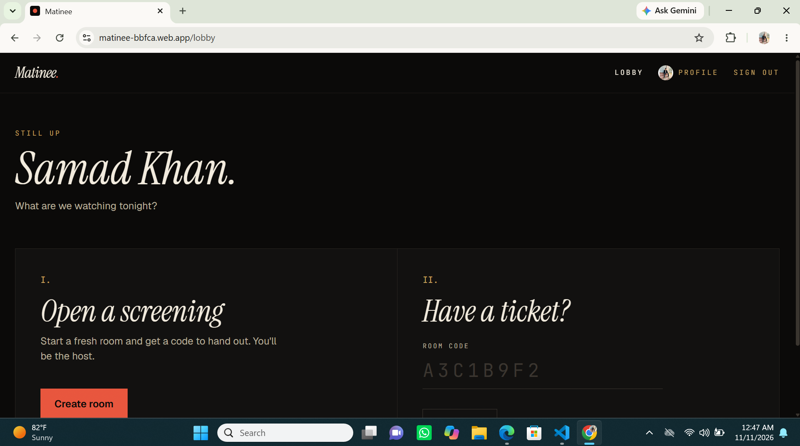
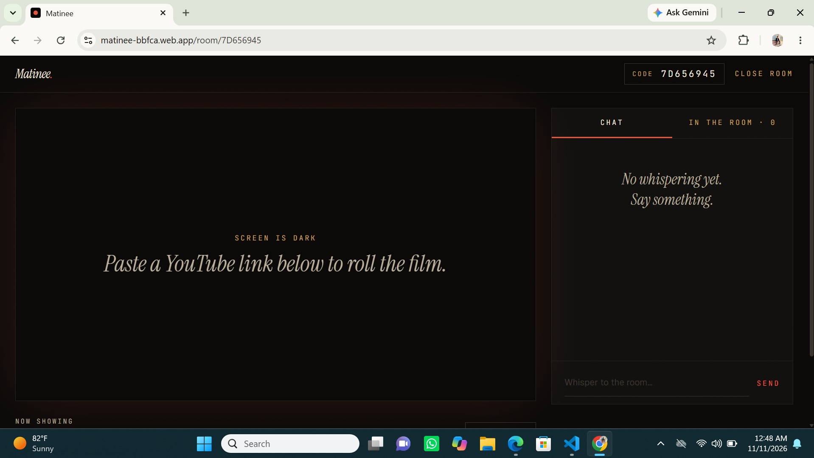
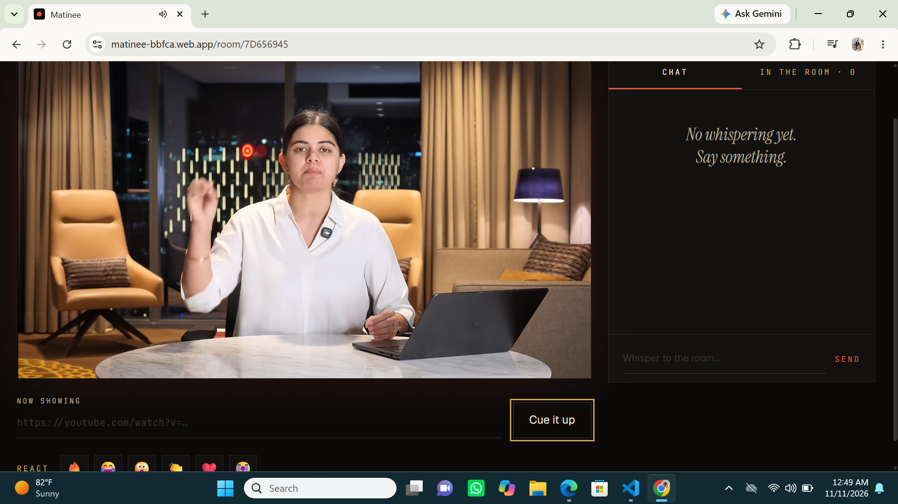

# Matinee

**A private screening room for YouTube.** Watch together in perfect sync, talk over it, react as a room.

[Live app](https://matinee-bbfca.web.app) · [Report a bug](#)

**Live demo:** https://matinee-bbfca.web.app
---

## Overview

Matinee is a real-time watch party web app. One person opens a room and shares an 8-character code. Everyone who joins sees the same YouTube video at the same moment, with live chat, shared emoji reactions, and a live list of who is in the room. The host controls who stays.

It is built around the feeling of a cozy private screening: a warm near-black palette, film grain, serif display type, ticket-stub room codes and a curtain that opens when you take your seat.

## Screenshots





## Features

- **Authentication**: email/password and Google sign-in (Firebase Auth), with protected routes and return-to-room after login
- **Rooms**: unique 8-digit hexadecimal codes, shareable as a code or an invite link
- **Synchronized playback**: video changes, play, pause and seeking are shared across everyone in the room, with automatic drift correction
- **Real-time chat**: messages stored and synced through Firestore
- **Shared reactions**: emoji reactions float up on every participant's screen
- **Live presence**: who is in the room right now, powered by Realtime Database `onDisconnect`
- **Host controls**: remove (and block) a participant, or close the room and wipe its data
- **Profile**: edit display name and phone number, change password
- **Security rules**: only members can read or write a room, only the host can kick or delete, message length is validated, and rooms cannot be listed

## Tech stack

| Layer | Tools |
|---|---|
| Frontend | React 18, Vite, Tailwind CSS v4, React Router, Framer Motion |
| Auth | Firebase Authentication |
| Database | Cloud Firestore (rooms, chat, playback, reactions, profiles) |
| Presence | Firebase Realtime Database |
| Video | YouTube IFrame Player API |
| Hosting | Firebase Hosting |

## How playback sync works

`rooms/{code}/meta/playback` is the single source of truth:

```js
{
  videoId,
  state: 'playing' | 'paused',
  position,
  updatedAt: (server timestamp),
  updatedBy
}
```

While playing, the live position is `position + (serverNow - updatedAt)`. Server time comes from the Realtime Database clock offset, so a wrong system clock on one device does not matter. Local player events become writes, remote writes become player commands, and a 3-second timer hard-seeks anyone who drifts more than 1.5 seconds. Volume is intentionally local to each viewer.

## Project structure

```text
matinee/
├── public/
├── src/
│   ├── components/
│   │   ├── room/
│   │   │   ├── ChatPanel.jsx        # chat list and input
│   │   │   ├── PeoplePanel.jsx      # who is in the room, host kick
│   │   │   ├── RoomNotice.jsx       # missing / kicked / closed states
│   │   │   └── VideoStage.jsx       # screen, URL bar, reactions
│   │   ├── Avatar.jsx
│   │   ├── Bulbs.jsx                # marquee bulbs
│   │   ├── Curtain.jsx              # curtain reveal on joining
│   │   ├── Logo.jsx
│   │   ├── Navbar.jsx
│   │   └── ProtectedRoute.jsx
│   ├── context/
│   │   └── AuthContext.jsx           # auth state and actions
│   ├── hooks/
│   │   ├── useChat.js
│   │   ├── usePlaybackSync.js        # YouTube player <-> Firestore sync
│   │   ├── usePresence.js            # Realtime Database presence
│   │   ├── useReactions.js
│   │   └── useRoom.js                # join, membership, kicked / closed
│   ├── lib/
│   │   ├── firebase.js
│   │   ├── roomCode.js
│   │   ├── rooms.js                  # create / kick / delete room
│   │   ├── serverClock.js             # server time offset
│   │   └── youtube.js                 # URL parsing and API loader
│   ├── pages/
│   │   ├── Auth.jsx
│   │   ├── Landing.jsx
│   │   ├── Lobby.jsx
│   │   ├── Profile.jsx
│   │   └── Room.jsx
│   ├── App.jsx
│   ├── index.css                      # design system (theme tokens)
│   └── main.jsx
├── .env.example
├── database.rules.json                # Realtime Database rules
├── firebase.json
├── firestore.rules                    # Firestore security rules
├── index.html
├── package.json
└── vite.config.js
```

## Getting started

### 1. Clone and install

```bash
git clone https://github.com/<your-username>/matinee.git
cd matinee
npm install
```

### 2. Create a Firebase project

1. Create a project in the [Firebase console](https://console.firebase.google.com) and register a **Web app**.
2. **Authentication**: enable *Email/Password* and *Google*.
3. **Firestore**: create a database (production mode).
4. **Realtime Database**: create a database (locked mode) and copy its URL.

### 3. Configure environment variables

```bash
cp .env.example .env
# Windows:
copy .env.example .env
```

Fill in the values from Project settings (no quotes, no angle brackets):

```env
VITE_FIREBASE_API_KEY=
VITE_FIREBASE_AUTH_DOMAIN=
VITE_FIREBASE_PROJECT_ID=
VITE_FIREBASE_APP_ID=
VITE_FIREBASE_MESSAGING_SENDER_ID=
VITE_FIREBASE_DATABASE_URL=
```

### 4. Deploy the security rules

```bash
npx firebase-tools login
npx firebase-tools use <your-project-id>
npx firebase-tools deploy --only "firestore:rules,database"
```

### 5. Run it

```bash
npm run dev
```

## Deployment

```bash
npm run build
npx firebase-tools deploy --only hosting
```

## Roadmap

- Support for more video platforms (Vimeo, Twitch)
- Room history and shared playlists
- Pagination and optimized state management for large rooms
- Further accessibility and mobile polish

## Author

**Abdul Samad Khan**  
BS Computer Science

## License

MIT
